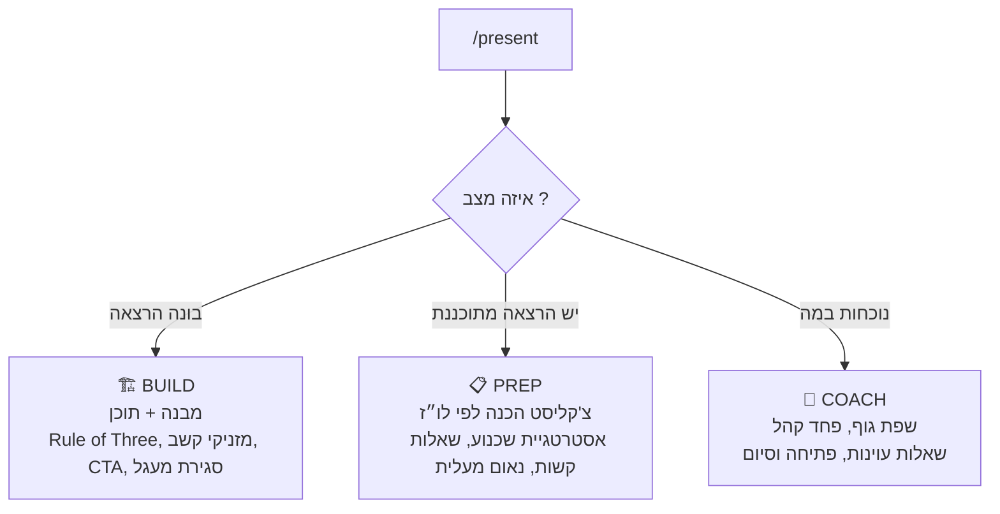
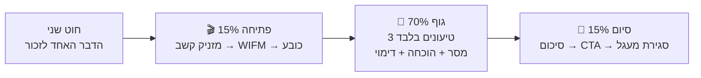

# present 🎤

**סקיל ל-Claude Code שהופך אותך לדובר טוב יותר: בונה לך הרצאה משכנעת, מכין אותך אליה, ומאמן אותך על הבמה. הכל לפי תיאוריית שכנוע, סטוריטלינג ושפת גוף, לא טיפים גנריים.**

רוב האנשים ניגשים להרצאה עם מצגת עמוסת בולטים ותקווה. הסקיל הזה עובד הפוך: קודם בונים חוט שני אחד שהקהל יזכור, אז בונים סביבו מבנה, מזניקי קשב וקריאה לפעולה. בעברית, בטון ישיר, מוכן לבמה.

---

## הבידול: לא טיפים, שיטה 🎓

חיפוש בגוגל "איך להעביר הרצאה" מחזיר את אותן 10 קלישאות. הסקיל הזה בנוי על מסגרות מוכחות מקורס שכנוע אקדמי, ומתרגם אותן לצעדים קונקרטיים על ההרצאה **שלך**.

| כלים אחרים | present |
|---|---|
| "תהיה בטוח בעצמך" | תרגיל חשיפה מדורג + מיקוד מהאגו לקהל |
| "אל תשים יותר מדי טקסט" | מקסימום 6 שורות, תמונה מעל בולט, מקש B להחשכה |
| "תפתח חזק" | מזניק קשב ספציפי, WIFM, ואז הכובע. לא "שלום קוראים לי" |
| מצגת = רשימת נושאים | 3 טיעונים בלבד (Rule of Three) סביב חוט שני אחד |

---

## שלושת המצבים



הסקיל מזהה את המצב מההקשר, או שואל אם לא ברור. שלושתם מכסים את מחזור החיים המלא של הרצאה: מדף חלק, דרך ההכנה, ועד הרגע מול הקהל.

---

## הלב: איך בונים הרצאה משכנעת



כל טיעון מקבל: מסר מרכזי במשפט, הוכחה (סיפור או נתון), דימוי שמגשר על פערי ידע, ומזניק קשב שמחזיק את הקהל ער.

---

## בסיס הידע שמוטמע בסקיל

| מסגרת | מה היא נותנת |
|---|---|
| 🗣️ **טבלת השכנוע** | 5 עקרונות: מוסר > מסר, בלתי מילולי > מילולי, סמוי > גלוי, רגש > היגיון, ידע > מידע |
| 🎩 **תורת הכובעים** | בחירת זהות שמייצרת בו-זמנית ייחודיות וגם מכנה משותף עם הקהל הספציפי |
| 📖 **נוסחת סטוריטלינג** | גיבור → קונפליקט → תגלית → גשר חזרה למסר |
| 📉 **עקומת הקשב** | הקשב צונח כל 5-10 דקות, לכן מתזמנים מזניקי קשב מראש |
| 🙌 **שפת גוף** | ידיים בגובה הטבור, קשר עין 90%, פרוקסמיקה, שתיקות דרמטיות |
| 🛗 **נאום מעלית** | נושא → טיזר → WIFM → למה אני, ב-30 שניות |

---

## שימוש

```
/present                  → אינטראקטיבי, שואל מה צריך
/present build [נושא]     → בונה מבנה ותוכן להרצאה
/present prep [אירוע]     → מכין אותך להרצאה מתוכננת
/present coach [מצב]      → אימון נוכחות במה, שפת גוף, שאלות
```

**טריגרים אוטומטיים:** "הרצאה", "פרזנטציה", "מצגת", "דיבור מול קהל", "פיץ'", "פחד קהל", "שפת גוף".

---

## מה מקבלים

- **`SKILL.md`** — שלושת המצבים המלאים + בסיס הידע (טבלת שכנוע, כובעים, עקומת קשב, שפת גוף, נאום מעלית, MAO, SMART)
- **מבנה הרצאה מוכן** — פתיחה-גוף-סיום עם אחוזי זמן, מדריך ויזואלי לשקפים, ומזניקי קשב מתוזמנים
- **דף הכנה** — צ'קליסט לפי לו״ז (שבוע / 3 ימים / יום / שעה לפני), 3 שאלות קשות עם תגובות, ונאום מעלית
- **`references/frameworks-cheatsheet.md`** — דף מרוכז אחד להדפסה ולהצצה מהירה רגע לפני שעולים לבמה

התוצרים נשמרים אוטומטית לקבצים ב-`outputs/presentations/`, לא רק בשיחה.

---

## מבנה הריפו

```
public-speaking-skill/
├── SKILL.md                          # הסקיל: 3 מצבים + בסיס ידע שכנוע
├── references/
│   └── frameworks-cheatsheet.md      # דף פריימוורקים מרוכז להדפסה
├── README.md
└── LICENSE
```

## התקנה

העתק את התיקייה לתיקיית הסקילים של Claude Code, והפעל עם `/present` או "בונה הרצאה" / "מתכונן לפיץ'" / "פחד קהל".

## שימוש הוגן ⚖️

הסקיל נותן מסגרות, מבנה וטקסט. התוכן, הנתונים והסיפורים הם שלך, ובאחריותך לוודא שהם נכונים. אל תציג נתון כעובדה בלי לאמת אותו.

## רישיון

MIT
