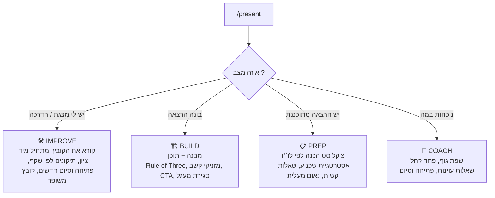
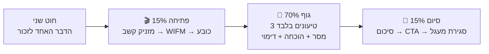

# present 🎤

**סקיל ל-Claude Code שהופך אותך לדובר טוב יותר: לוקח מצגת או הדרכה שכבר יש לך ומשפר אותה, בונה לך הרצאה משכנעת, מכין אותך אליה, ומאמן אותך על הבמה. הכל לפי תיאוריית שכנוע, סטוריטלינג ושפת גוף, לא טיפים גנריים.**

רוב האנשים ניגשים להרצאה עם מצגת עמוסת בולטים ותקווה. הסקיל הזה עובד הפוך: קודם בונים חוט שני אחד שהקהל יזכור, אז בונים סביבו מבנה, מזניקי קשב וקריאה לפעולה. בעברית, בטון ישיר, מוכן לבמה.

---

## הבידול: לא טיפים, שיטה 🎓

חיפוש בגוגל "איך להעביר הרצאה" מחזיר את אותן 10 קלישאות. הסקיל הזה בנוי על מסגרות מוכחות מקורס שכנוע אקדמי, ומתרגם אותן לצעדים קונקרטיים על ההרצאה **שלך**.

| כלים אחרים | present |
|---|---|
| "תהיה בטוח בעצמך" | תרגיל חשיפה מדורג + מיקוד מהאגו לקהל |
| "אל תשים יותר מדי טקסט" | מקסימום 6 שורות, תמונה מעל בולט, מקש B להחשכה |
| "תפתח חזק" | מזניק קשב ספציפי, WIFM, ואז הכובע. לא "שלום קוראים לי" |
| מצגת = רשימת נושאים | 3 טיעונים בלבד (Rule of Three) סביב חוט שני אחד |
| "תשתפו את הקהל" | מפת מעורבות מתוזמנת לפי סולם השתתפות, מבוססת על ניתוח וובינרים אמיתיים |

---

## ארבעת המצבים



הסקיל מזהה את המצב מההקשר, או שואל אם לא ברור. כשמצרפים קובץ או קישור, הוא נכנס ישר לשיפור בלי לשאול מה צריך. ארבעתם מכסים את מחזור החיים המלא של הרצאה: מדף חלק, דרך ההכנה, ועד הרגע מול הקהל.

---

## הלב: איך בונים הרצאה משכנעת



כל טיעון מקבל: מסר מרכזי במשפט, הוכחה (סיפור או נתון), דימוי שמגשר על פערי ידע, ומזניק קשב שמחזיק את הקהל ער.

---

## בסיס הידע שמוטמע בסקיל

| מסגרת | מה היא נותנת |
|---|---|
| 🗣️ **טבלת השכנוע** | 5 עקרונות: מוסר > מסר, בלתי מילולי > מילולי, סמוי > גלוי, רגש > היגיון, ידע > מידע |
| 🎩 **תורת הכובעים** | בחירת זהות שמייצרת בו-זמנית ייחודיות וגם מכנה משותף עם הקהל הספציפי |
| 📖 **נוסחת סטוריטלינג** | גיבור → קונפליקט → תגלית → גשר חזרה למסר |
| 📉 **עקומת הקשב** | הקשב צונח כל 5-10 דקות, לכן מתזמנים מזניקי קשב מראש |
| 🙌 **שפת גוף** | ידיים בגובה הטבור, קשר עין 90%, פרוקסמיקה, שתיקות דרמטיות |
| 🛗 **נאום מעלית** | נושא → טיזר → WIFM → למה אני, ב-30 שניות |
| 🔥 **סולם ההשתתפות** | מאימוג'י בצ'אט ועד מיקרופון פתוח, בהדרגה, עם נקודת השתתפות כל 7-8 דקות באונליין |
| 🔁 **סגירת מעגל** | שאלת פתיחה שחוזרים אליה, ודמות או מספר-עוגן שכל השוואה נשענת עליהם |
| 📎 **כלל המקורות** | מקור ורמת אמינות לכל נתון, וניפוץ נתון מוכר אחד בפתיחה |
| 💰 **שני מודלים למכירה** | מכירה מוצהרת עם גילוי נאות מוקדם, או הצעה רכה אחרי הערך וטיפ אחרון אחריה |

---

## חדש: ארגז כלים למעורבות קהל 🔥

`references/audience-engagement.md` נבנה מניתוח תמלולים מלאים של שני וובינרים ישראליים מ-2026: וובינר מכירה עם הדגמה חיה, ווובינר מקצועי בקהילה. השמות הוסרו. מה שנשאר:

- חימום לפני שמתחילים וחוזה פתיחה
- סולם ההשתתפות וסגירת מעגל
- כלל המקורות והקהל כתוכן
- הדגמה חיה שהקהל עושה ביחד, ואיפה היא נשברת
- מה מחזיק קהל עד הסוף, ומה זה עולה באמון
- שני מודלים למכירה, שאלות ותשובות וסיום
- מה לא להעתיק

הסקיל קורא את הקובץ אוטומטית כשבונים וובינר, סדנה או הרצאה עם הצעה בסוף.

---

## שימוש

```
/present [קובץ או קישור]   → משפר מצגת/הדרכה קיימת, מתחיל מיד
/present improve [קובץ]   → אותו דבר, במפורש
/present                  → אינטראקטיבי, שואל מה צריך
/present build [נושא]     → בונה מבנה ותוכן להרצאה
/present prep [אירוע]     → מכין אותך להרצאה מתוכננת
/present coach [מצב]      → אימון נוכחות במה, שפת גוף, שאלות
```

**טריגרים אוטומטיים:** "הרצאה", "פרזנטציה", "מצגת", "דיבור מול קהל", "פיץ'", "פחד קהל", "שפת גוף", "וובינר", "סדנה", "לשתף את הקהל".

---

## מה מקבלים

- **שיפור מצגת קיימת** — קורא PPTX, PDF, Gamma, Google Slides, Canva או תסריט. נותן ציון ב-15 בדיקות, 3-5 תיקונים לפי סדר חשיבות, טבלת שקף-אחר-שקף, פתיחה וסיום כתובים, מפת מעורבות, וקובץ `_משופר` חדש ליד המקור (המקור לא נדרס). העיצוב נשאר שלך, התוכן משתפר.
- **`SKILL.md`** — שלושת המצבים המלאים + בסיס הידע (טבלת שכנוע, כובעים, עקומת קשב, שפת גוף, נאום מעלית, MAO, SMART)
- **מבנה הרצאה מוכן** — פתיחה-גוף-סיום עם אחוזי זמן, מדריך ויזואלי לשקפים, ומזניקי קשב מתוזמנים
- **דף הכנה** — צ'קליסט לפי לו״ז (שבוע / 3 ימים / יום / שעה לפני), 3 שאלות קשות עם תגובות, ונאום מעלית
- **`references/frameworks-cheatsheet.md`** — דף מרוכז אחד להדפסה ולהצצה מהירה רגע לפני שעולים לבמה
- **`references/audience-engagement.md`** — ארגז כלים למעורבות קהל, עם שכבה ייעודית לוובינרים
- **מפת מעורבות** — בכל מבנה הרצאה: מתי הקהל משתתף, איך, ולאן זה מתחבר בהמשך

התוצרים נשמרים אוטומטית לקבצים ב-`outputs/presentations/`, לא רק בשיחה.

---

## מבנה הריפו

```
public-speaking-skill/
├── SKILL.md                          # הסקיל: 3 מצבים + בסיס ידע שכנוע
├── references/
│   ├── frameworks-cheatsheet.md      # דף פריימוורקים מרוכז להדפסה
│   └── audience-engagement.md        # ארגז כלים למעורבות קהל ווובינרים
├── README.md
└── LICENSE
```

## התקנה

העתק את התיקייה לתיקיית הסקילים של Claude Code, והפעל עם `/present` או "בונה הרצאה" / "מתכונן לפיץ'" / "פחד קהל".

## שימוש הוגן ⚖️

הסקיל נותן מסגרות, מבנה וטקסט. התוכן, הנתונים והסיפורים הם שלך, ובאחריותך לוודא שהם נכונים. אל תציג נתון כעובדה בלי לאמת אותו.

## רישיון

MIT
