# אחרי: תוכן השקפים והערות הדובר

## שקף 1: 3 שעות בשבוע חוזרות אליכם

- אוטומציה לצוות הכספים | 25 דקות, תהליך אחד שלכם

**הערות דובר:** לא לפתוח ב"שלום קוראים לי". שאלה ראשונה, ידיים למעלה: "מי הקליד היום נתונים מחשבונית? מי פעמיים? מי הפסיק לספור?" (סולם השתתפות 1). סקר פתיחה שחוזרים אליו בסוף: "כמה שעות בשבוע הולכות לכם על הקלדה והעתקה? 1) פחות משעה 2) 1-3 3) יותר מ-3".

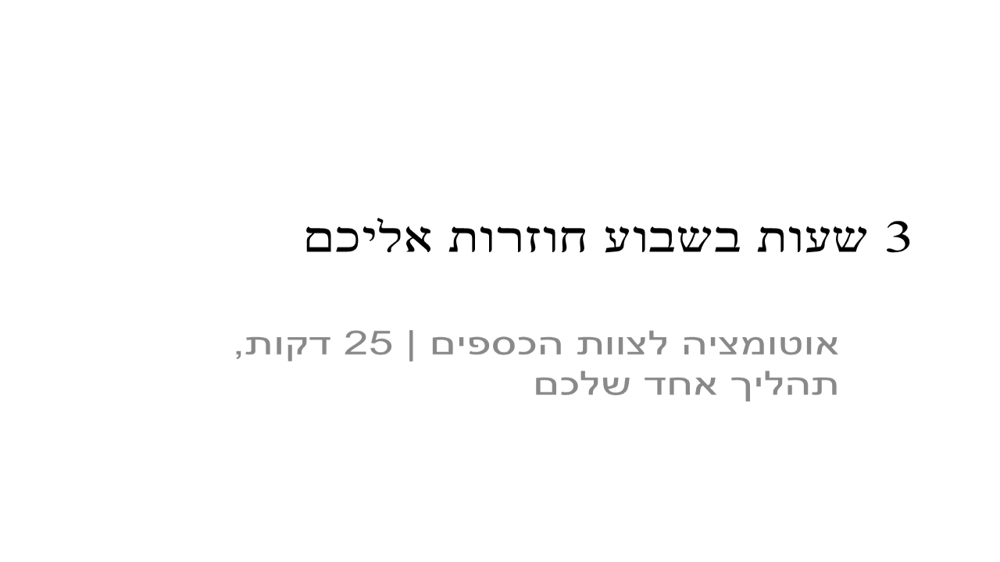

## שקף 2: חשבונית אחת. 7 דקות.

- תזכרו את המספר הזה

**הערות דובר:** מספר-עוגן. לפני החשיפה: "כמה זמן לוקח לכם להזין חשבונית ספק אחת מהמייל ועד המערכת? תנחשו" (ניחוש לפני חשיפה). ה-7 דקות הוא הערכה לבדיקה: למדוד אצל הצוות לפני ההרצאה ולהחליף במספר האמיתי.

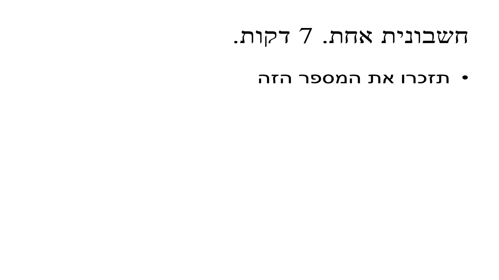

## שקף 3: מה תצאו עם זה מפה

- תהליך אחד שלכם שמתאים לאוטומציה
- איזה כלי מתאים לו
- צעד ראשון למחר בבוקר
- מסיימים בדקה 25

**הערות דובר:** חוזה פתיחה: הבטחה מוחשית + 3 חלקים + שעת סיום. הכובע: "אני לא מתכנת. אני מי שבנה אוטומציה לחשבוניות בארגון גדול" (להתאים לכובע האמיתי מול הקהל הזה).

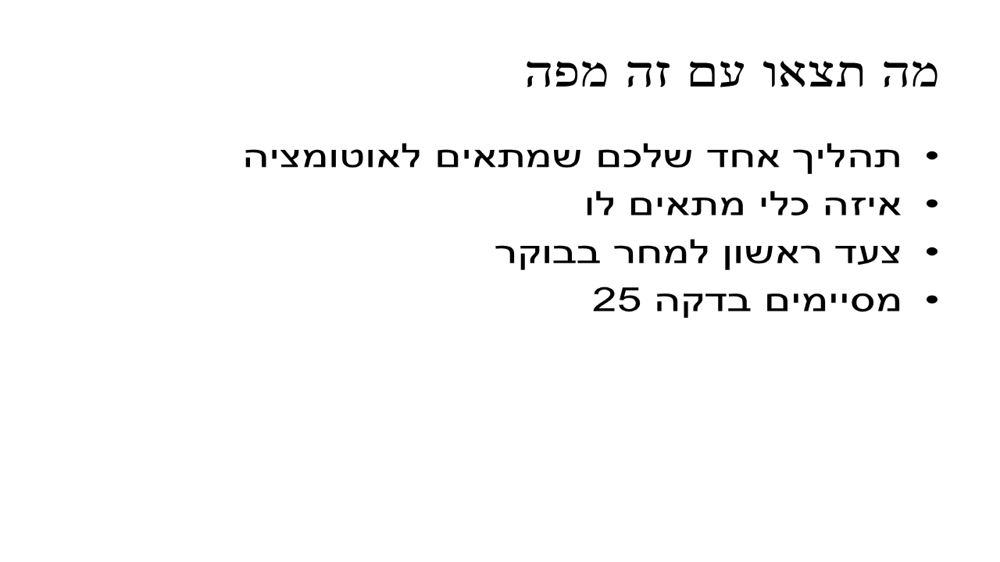

## שקף 4: אם עשיתם את זה באותו סדר בשבוע שעבר

- מחשב יכול לעשות את זה השבוע

**הערות דובר:** זה החוט השני של כל ההרצאה. במקום הגדרה של אוטומציה ו-8 בולטים. אחרי השקף: "תכתבו על פתק משימה אחת שעשיתם השבוע באותו סדר בדיוק". הפתקים חוזרים בשקף "התהליך שלכם".

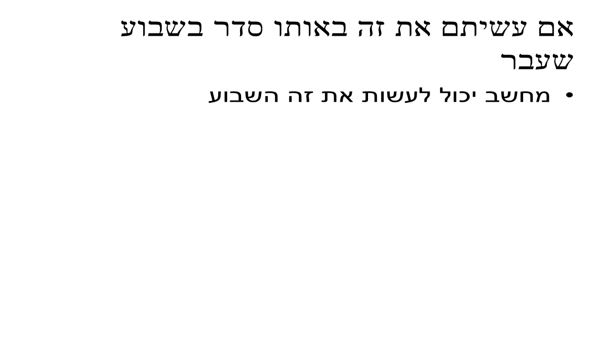

## שקף 5: הסיפור: חשבוניות ספקים

- לפני: מייל → הקלדה → בדיקה → אישור → תשלום
- 7 דקות × 400 חשבוניות בחודש
- אחרי: המייל נקלט, הנתונים מחולצים, המנהל מאשר בלחיצה
- האדם בודק רק חריגות

**הערות דובר:** סיפור עם גיבור (רכזת חשבונות ספציפית, בשם בדוי), קונפליקט (סוף חודש, 400 חשבוניות), תגלית, גשר: "כל תהליך שיש לו מייל, טבלה ואישור עובד ככה". המספרים כאן להמחשה: להחליף בנתונים אמיתיים מהלקוח, עם מקור.

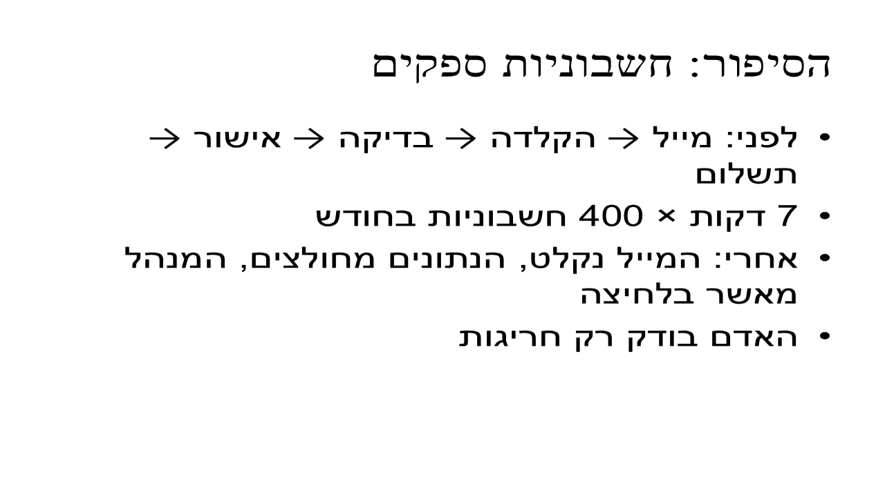

## שקף 6: 3 מספרים שמסתובבים

- 80% מהמשימות בכספים ניתנות לאוטומציה [מקור חסר]
- 40% מהזמן על משימות חוזרות [מקור חסר]
- החזר השקעה תוך 3 חודשים [מקור חסר]

**הערות דובר:** כלל המקורות: לכל מספר מקור + רמת אמינות. אם אין מקור, להגיד "אין לזה מקור" או להחליף במספר שמדדתם אצלכם. ניפוץ אפשרי: לחפש מאיפה הגיע ה-80% ולהראות שזה סקר של ספק כלים. מחקתי "זה לא עוד כלי, זו מהפכה".

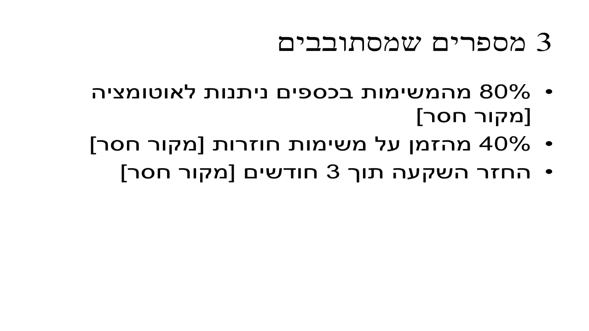

## שקף 7: התאמות בנק: מי עושה את זה ידנית?

- דוח בנק → השוואה → סימון הפרשים
- ידיים למעלה

**הערות דובר:** נקודת השתתפות (סולם 1-2), בערך דקה 10. "מי עושה התאמות בנק ידנית? מי פעם בחודש? מי כל שבוע?" להקריא שמות. לשאול אחד מהם כמה זמן זה לוקח לו, וזה דוגמה חיה.

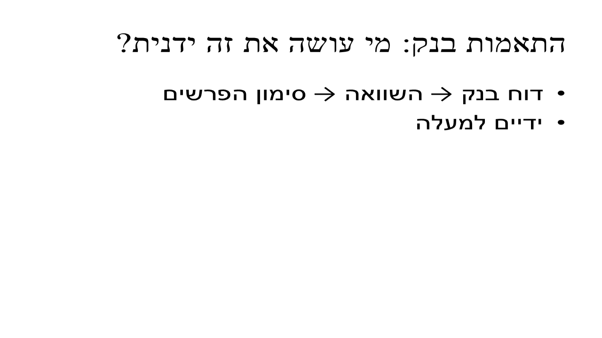

## שקף 8: איזה כלי מתי

| מחיר | מתי | כלי |
| כלול ברישוי | כבר יש Microsoft 365 | Power Automate |
| לפי פעולות | עסק קטן, הרבה אפליקציות | Make |
| קוד פתוח | יש מישהו טכני בצוות | n8n |

**הערות דובר:** מחליף 4 שקפים של רשימות כלים. 3 כלים בלבד (Rule of Three). Zapier, UiPath ו-Python יצאו: להזכיר בעל-פה אם שואלים. ניחוש לפני חשיפה: "באיזה כלי אתם חושבים שהארגון שלכם כבר משלם?" (תשובה: Power Automate, כלול ברישוי 365).

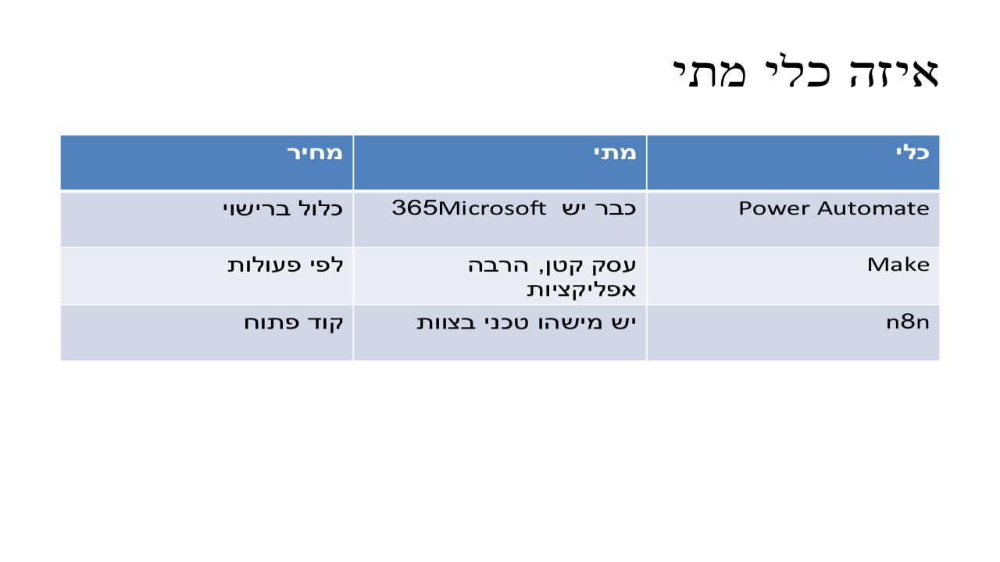

## שקף 9: התהליך שלכם

- הפתקים מתחילת ההרצאה
- בוחרים 2 ומפרקים אותם עכשיו: טריגר → פעולות → אישור

**הערות דובר:** הקהל כתוכן. לאסוף את הפתקים, לבחור 2, ולפרק על הלוח מול כולם. אפשר לאסוף מראש: שאלה בהזמנה "איזו משימה חוזרת הכי מעצבנת אתכם?". זו נקודת ההשתתפות הגדולה, בערך דקה 15.

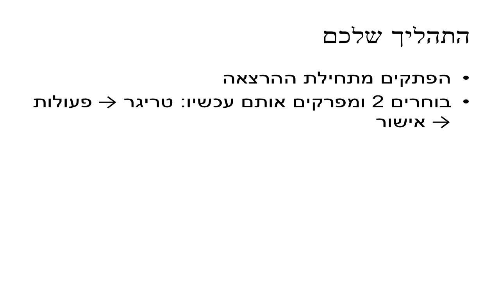

## שקף 10: שאלות

- לפני הסיכום

**הערות דובר:** שאלות לפני הסיכום, לא בשקף האחרון. 3-4 דקות. אם שואלים על כלי שלא הוצג: "לא הבאתי אותו כי..." בלי מכירה.

## שקף 11: 3 דברים לקחת

- אותו סדר כל שבוע = מועמד לאוטומציה
- מתחילים מהכלי שכבר משלמים עליו
- מודדים דקות לפני, כדי לדעת מה הרווחתם

**הערות דובר:** סיכום 3 משפטים. סגירת מעגל: לחזור לסקר הפתיחה. "מי שענה יותר מ-3 שעות: התהליך מהפתק שלכם הוא המקום להתחיל."

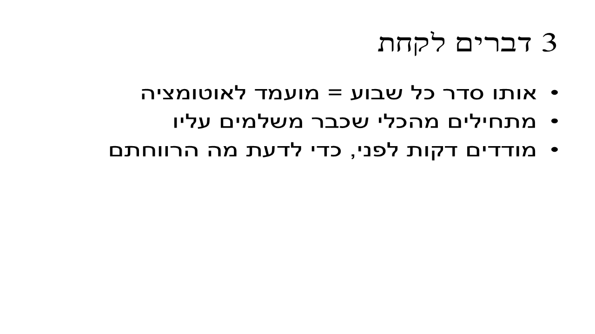

## שקף 12: עד יום חמישי

- שלחו לי תהליך אחד + כמה דקות הוא לוקח
- אחזור עם הצעה איך להפוך את 7 הדקות ל-0

**הערות דובר:** קריאה לפעולה ספציפית עם תאריך. חזרה למספר-העוגן 7 דקות.

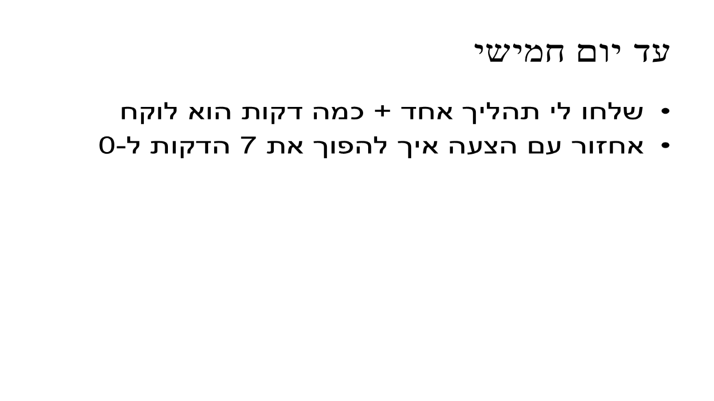

## שקף 13: טיפ אחרון

- כללים ב-Outlook שמעבירים חשבוניות לתיקייה אחת
- 5 דקות הגדרה, היום אחר הצהריים

**הערות דובר:** מסיימים בערך ולא ב"תודה רבה". הדבר האחרון שהקהל זוכר הוא משהו שאפשר לעשות היום.

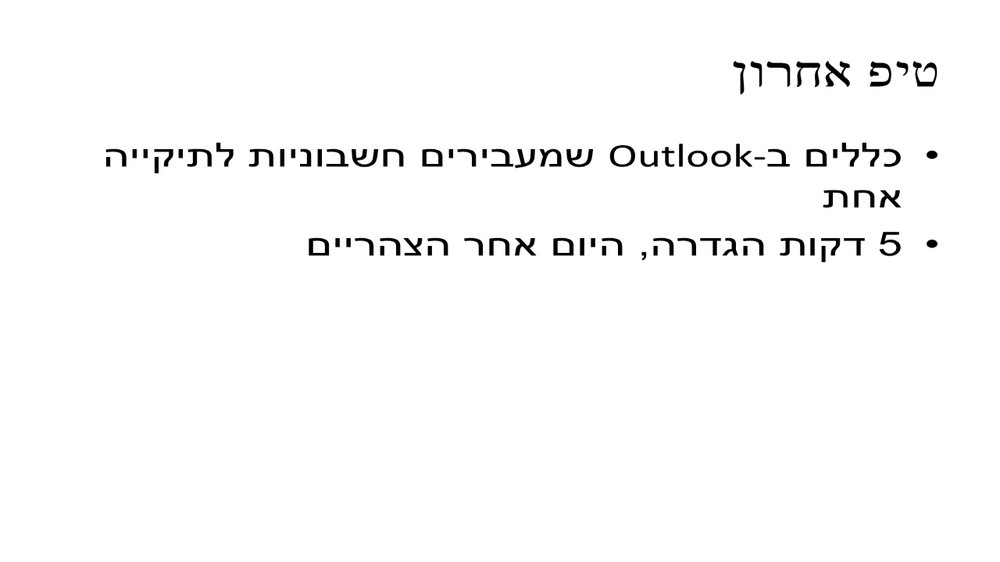
