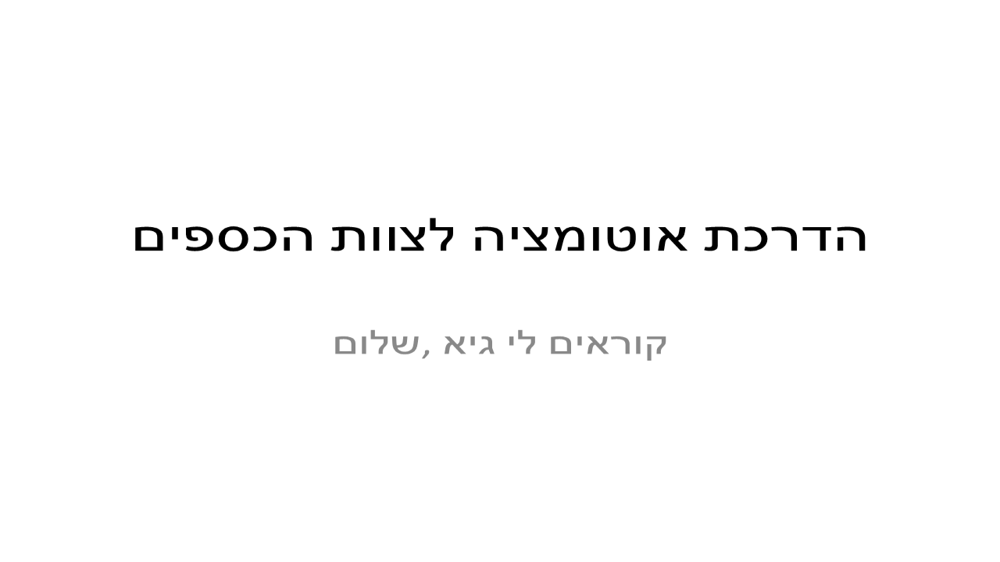
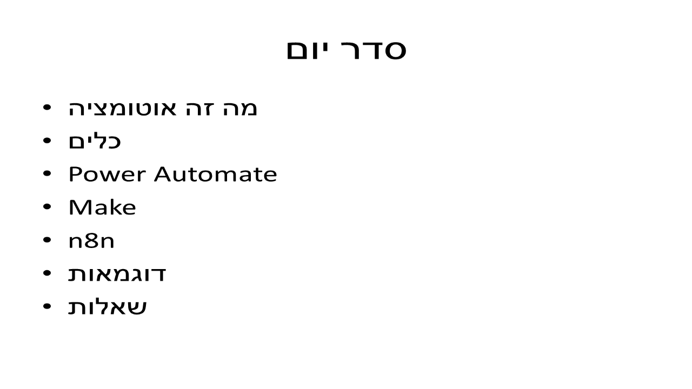
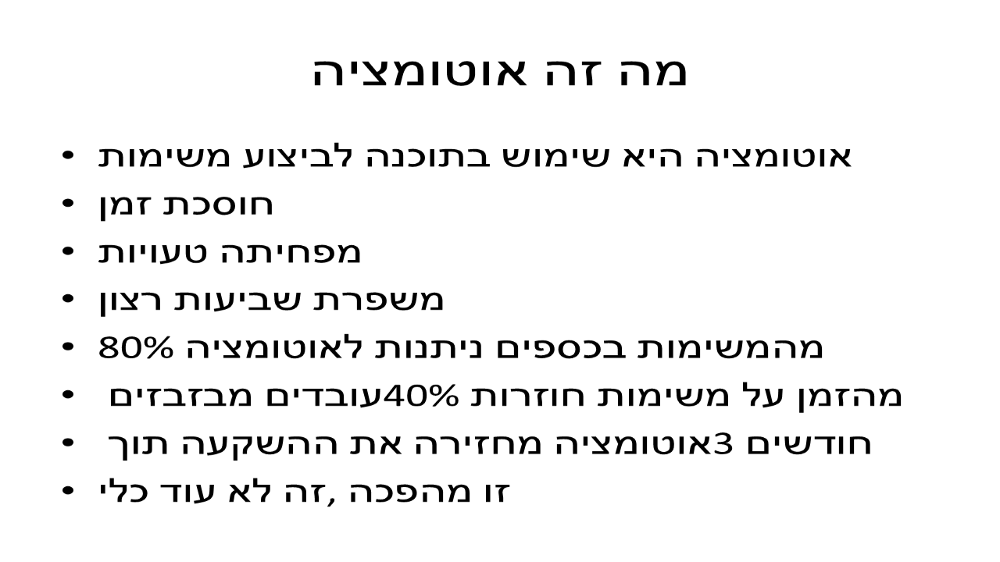
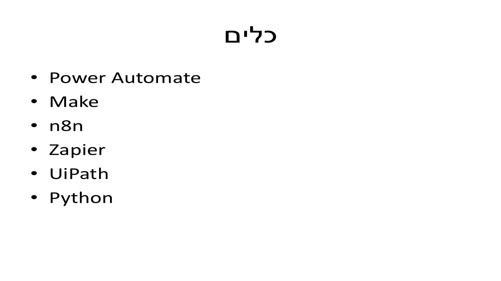
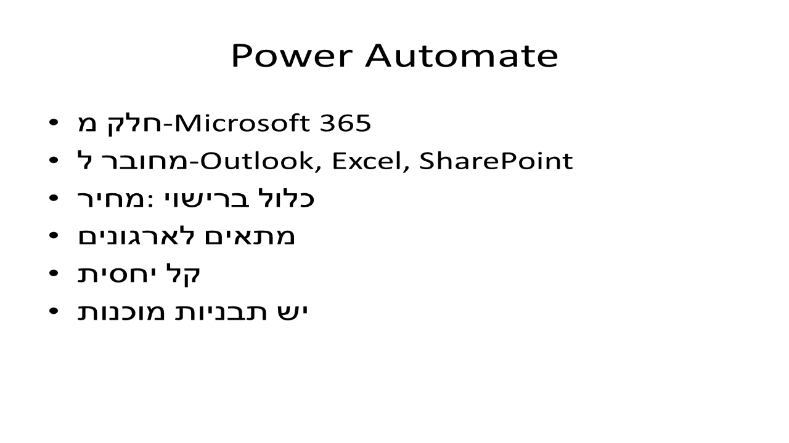
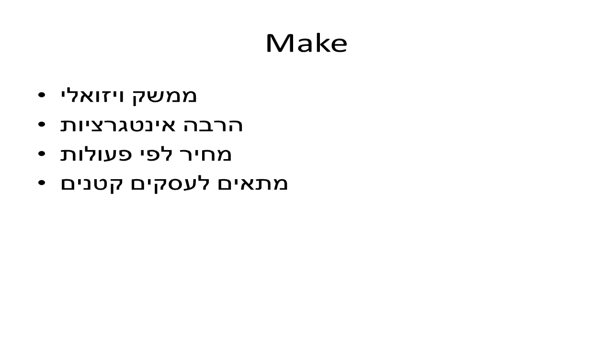
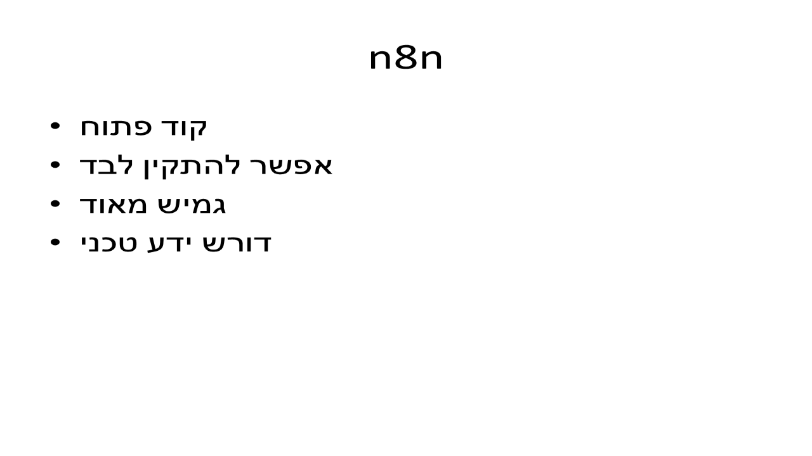
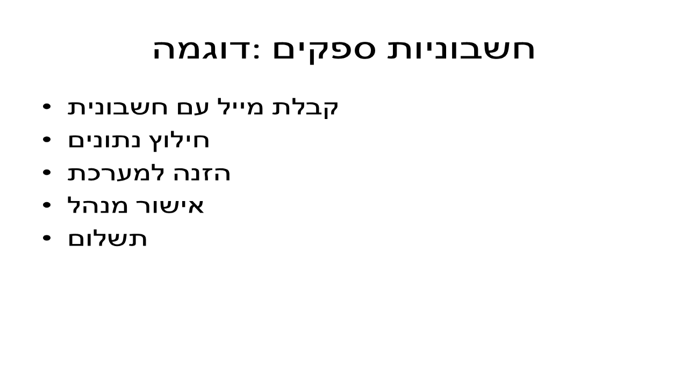
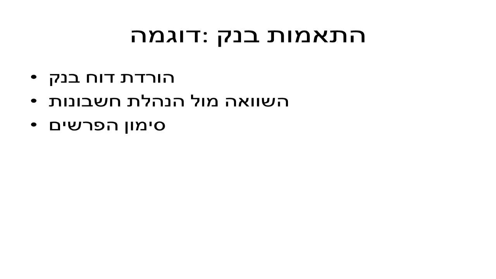
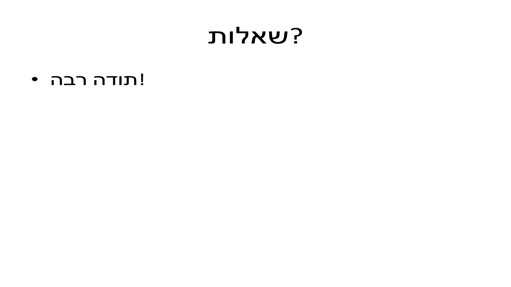

# לפני: תוכן השקפים והערות הדובר

## שקף 1: הדרכת אוטומציה לצוות הכספים

- שלום, קוראים לי גיא

**הערות דובר:** (אין)

## שקף 2: סדר יום

- מה זה אוטומציה
- כלים
- Power Automate
- Make
- n8n
- דוגמאות
- שאלות

**הערות דובר:** (אין)

## שקף 3: מה זה אוטומציה

- אוטומציה היא שימוש בתוכנה לביצוע משימות
- חוסכת זמן
- מפחיתה טעויות
- משפרת שביעות רצון
- 80% מהמשימות בכספים ניתנות לאוטומציה
- עובדים מבזבזים 40% מהזמן על משימות חוזרות
- אוטומציה מחזירה את ההשקעה תוך 3 חודשים
- זה לא עוד כלי, זו מהפכה

**הערות דובר:** (אין)

## שקף 4: כלים

- Power Automate
- Make
- n8n
- Zapier
- UiPath
- Python

**הערות דובר:** (אין)

## שקף 5: Power Automate

- חלק מ-Microsoft 365
- מחובר ל-Outlook, Excel, SharePoint
- מחיר: כלול ברישוי
- מתאים לארגונים
- קל יחסית
- יש תבניות מוכנות

**הערות דובר:** (אין)

## שקף 6: Make

- ממשק ויזואלי
- הרבה אינטגרציות
- מחיר לפי פעולות
- מתאים לעסקים קטנים

**הערות דובר:** (אין)

## שקף 7: n8n

- קוד פתוח
- אפשר להתקין לבד
- גמיש מאוד
- דורש ידע טכני

**הערות דובר:** (אין)

## שקף 8: דוגמה: חשבוניות ספקים

- קבלת מייל עם חשבונית
- חילוץ נתונים
- הזנה למערכת
- אישור מנהל
- תשלום

**הערות דובר:** (אין)

## שקף 9: דוגמה: התאמות בנק

- הורדת דוח בנק
- השוואה מול הנהלת חשבונות
- סימון הפרשים

**הערות דובר:** (אין)

## שקף 10: שאלות?

- תודה רבה!

**הערות דובר:** (אין)

